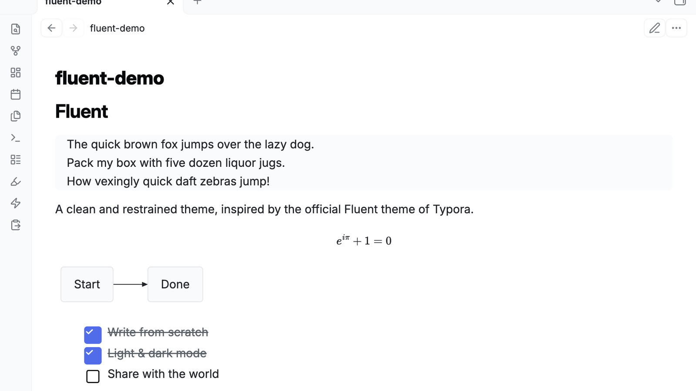
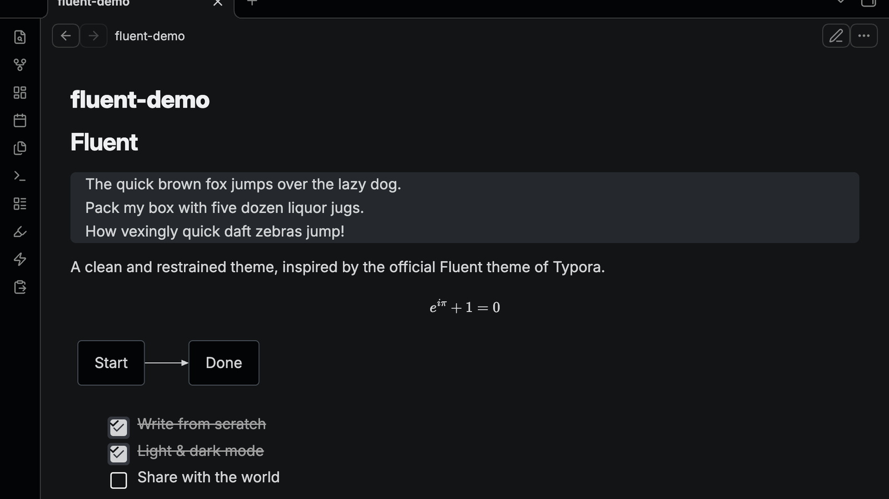

# Fluent

**[English](#english) | [中文](#中文)**

A clean and restrained Obsidian theme, **inspired by the official Fluent theme of [Typora](https://typora.io)**. All CSS is written from scratch.

| Light | Dark |
| :-: | :-: |
|  |  |

---

## English

### Highlights

- **Two-layer gray interface** — pure white content (`#ffffff`) on light gray cards (`#fafbfc`); graphite base (`#131416`) with a near-black sidebar (`#030405`) in dark mode
- **Card-style blockquotes** — no left accent bar, just a soft gray card, exactly like Typora's Fluent; the gray padding above and below the text is adjustable (0–24px)
- **Card-style tables** — 8px rounded corners, hairline borders, zebra stripes, tabular numerals (`tnum`)
- **Rendered preview cards** — Mermaid diagrams and LaTeX math blocks render inside the same gray Fluent card with rounded corners
- **Fluent checkboxes** — 24px square task-list checkboxes with a dedicated white checkmark layer for consistent contrast in light and dark mode
- **Six callout accent colors** — bookmark (indigo), star (blue), tip (yellow), note (teal), warning (red), question (pink); also supports Typora's "blockquote + heading" syntax
- **macOS-style radius** — blockquotes, tables, code blocks and callouts share a unified 8px corner radius
- **Typography** — Inter for headings and body text, JetBrains Mono for code; loaded from CDN with automatic system-font fallback (PingFang SC / Source Han Sans for CJK)
- **Style Settings support** — optional [Style Settings](https://github.com/mgmeyers/obsidian-style-settings) integration: tooltip bubble toggle, card-radius and blockquote-radius sliders, and blockquote top/bottom padding

### Installation

**Community theme store**: Settings → Appearance → Themes → Manage → search “Fluent”.

**Manual**: copy `theme.css` and `manifest.json` into `<your vault>/.obsidian/themes/Fluent/`, then enable it under Settings → Appearance.

### Customization

**With the [Style Settings](https://github.com/mgmeyers/obsidian-style-settings) plugin** (recommended), you get a Fluent section in its settings panel:

- **Light tooltips in light mode** — switch tooltips between the default dark bubble (white text) and a light bubble (dark text)
- **Card corner radius** — 0 to 16px slider for tables, code blocks, callouts and rendered preview boxes (Mermaid, LaTeX)
- **Blockquote corner radius** — independent 0 to 16px slider for blockquotes
- **Blockquote top/bottom padding** — 0 to 24px slider for the gray padding above and below quote text (left and right stay fixed); set it to 16px for equal padding on all four sides

**Without any plugin**, override the CSS variables directly in Settings → Appearance → CSS snippets:

```css
/* Light bubble with dark text for tooltips in light mode */
.theme-light .tooltip {
    --tooltip-background: #ffffff;
    --tooltip-color: #1f2328;
}

/* Corner radius for tables / code blocks / callouts / preview boxes */
body {
    --fluent-radius: 10px;
}

/* Corner radius for blockquotes (independent) and gray padding above/below quote text */
body {
    --fluent-quote-radius: 8px;
    --fluent-quote-vborder: 12px;
}
```

Other useful variables: `--text-link` (link color), `--elevated-background` (card background), `--mark-bg` (highlight background).

### Compatibility

- Obsidian 1.4.0+
- Reading view, Live Preview and Source mode
- Dark mode follows the app appearance setting automatically

---

## 中文

### 设计要点

- **双层灰阶界面**：浅色为纯白底（`#ffffff`）+ 浅灰卡片（`#fafbfc`）；深色为石墨底（`#131416`）+ 近黑侧栏（`#030405`）
- **纯灰底引用块**：没有左侧竖线的卡片式引用块，与 Typora Fluent 一致；文字上、下方的灰色厚度可在 0–24px 间调节
- **卡片式表格**：8px 圆角外框、细边框、斑马纹、等宽数字（`tnum`）
- **预览卡片统一风格**：Mermaid 图表与 LaTeX 公式块同样渲染为灰底 Fluent 卡片，带圆角
- **Fluent 复选框**：24px 方形任务列表复选框，使用独立白色勾号图层，在浅色与深色模式下均保持清晰对比
- **六种 Callout 语义色**：收藏（蓝紫）、星标（蓝）、灵感（黄）、笔记（青绿）、警告（红）、疑问（粉），同时兼容 Typora 的「引用块 + 首行标题」写法
- **macOS 风格圆角**：引用块、表格、代码块、Callout 统一 8px
- **字体**：标题/正文 Inter，代码 JetBrains Mono，在线加载、离线自动回退系统字体（中文回退苹方 / 思源黑体）
- **支持 Style Settings 插件**：可切换提示气泡深浅样式、拖动调整卡片圆角、引用块圆角与上下灰边厚度

### 安装

**社区主题商店**：Obsidian → 设置 → 外观 → 主题 → 管理 → 搜索 “Fluent”。

**手动安装**：将本仓库的 `theme.css` 与 `manifest.json` 复制到 `<你的库>/.obsidian/themes/Fluent/` 目录下，然后在 设置 → 外观 中启用。

### 自定义

**装了 [Style Settings](https://github.com/mgmeyers/obsidian-style-settings) 插件**（推荐）后，在它的设置面板里会出现 Fluent 分区：

- **浅色模式使用浅色提示气泡**——在默认深灰气泡（白字）和白底气泡（黑字）之间切换
- **卡片圆角**——0 到 16px 滑块，控制表格、代码块、Callout、Mermaid / LaTeX 预览框的圆角
- **引用块圆角**——引用块独立的 0 到 16px 圆角滑块
- **引用块上下灰边厚度**——0 到 24px 滑块，控制灰底在文字上方、下方的厚度（左右固定不动）；拉到 16px 即四边等宽

**不装插件**也可以直接在 设置 → 外观 → CSS 代码片段 里覆盖变量：

```css
/* 浅色模式提示气泡改为白底黑字 */
.theme-light .tooltip {
    --tooltip-background: #ffffff;
    --tooltip-color: #1f2328;
}

/* 圆角大小：表格 / 代码块 / Callout / 预览框统一生效 */
body {
    --fluent-radius: 10px;
}

/* 引用块圆角（独立）与灰底上下厚度 */
body {
    --fluent-quote-radius: 8px;
    --fluent-quote-vborder: 12px;
}
```

其他可调变量：`--text-link`（链接色）、`--elevated-background`（灰底卡片色）、`--mark-bg`（高亮底色）。

### 兼容说明

- 支持 Obsidian 1.4.0+
- 同时适配阅读视图、实时预览（Live Preview）和源码模式
- 深色模式随 Obsidian 外观设置自动切换，无需额外配置

---

## Repository structure

```
├── theme.css             All theme styles (light & dark)
├── manifest.json         Theme manifest
├── screenshot.png        Store thumbnail (512×288, light)
├── screenshot-dark.png   Store thumbnail (512×288, dark)
├── cover-light.png       README preview (1600×900, light)
├── cover-dark.png        README preview (1600×900, dark)
└── LICENSE               MIT
```

## Credits & License

Visual design inspired by the official Fluent theme of Typora. The Obsidian implementation is original work, released under the [MIT License](./LICENSE).
